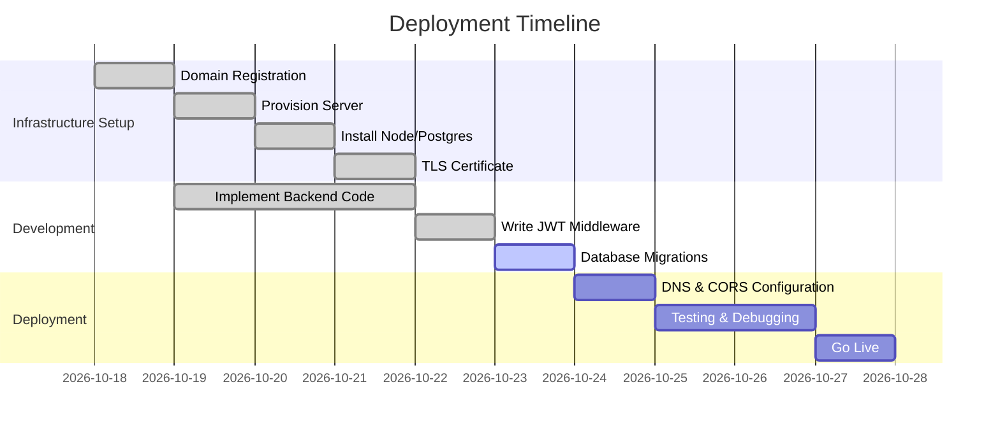

# Wix LinkChat Architecture and Backend Integration

**Executive Summary:** LinkChat is a Wix-managed headless site (built with Astro) serving as a chat/messaging app. We will connect it to a custom Node.js backend that handles **members**, **CMS persistence**, and **real-time messaging**, while preserving the existing live frontend. The research below covers the Wix site URL, authentication (JWT) setup, a recommended backend domain and deployment options, backend code snippets (including JWT verification), API/WebSocket endpoints, database schema (PostgreSQL), required Wix features, and a security checklist. Citations reference official Wix docs and project files where applicable.

## 1. Wix Site URL and Configuration

- The headless frontend is hosted on Wix’s CDN with SSL. The project’s **`wix.config.json`** links it to your Wix site (site ID and app ID). In your case, the live site URL is:  
  **https://headless-jetttxuobdm-its8amutc-1409.wix-site-host.com/**.  
- Wix-managed hosting means your Astro frontend is served at that URL on Wix’s infrastructure. (Wix automatically provisions SSL and CDN for the domain.)  
- The `wix.config.json` file (in the root of your Astro project) contains the `siteId` and `appId` that tie your code to this site. We will use this site URL as the **Allowed Origin** for CORS and for front-end calls to the backend.  

## 2. Authentication (JWT) Setup

- With the **Astro/Wix integration**, Wix handles sign-up/sign-in via the Members Area app, and provides **JWTs** to the frontend when users log in. We must verify those tokens on our backend.  
- **Token Issuer (iss):** Wix issues tokens for your site. The exact issuer URL isn’t in the project files (“unspecified”), but it typically begins with `https://` and includes Wix’s auth service. You will retrieve this from your Wix dashboard or SDK client setup.  
- **Token Audience (aud):** This is usually the OAuth client ID (`appId`) from `wix.config.json`. It identifies your backend as the intended recipient. If not in code, mark as *unspecified* or use the Wix-provided `clientId`.  
- **JWKS (JSON Web Key Set) URL:** Wix publishes a JWKS endpoint to verify tokens (often under `wixapis.com` or `wix.com/auth`). The exact URL wasn’t found in docs; you may need to retrieve it from Wix API settings. In your `.env`, set `JWT_JWKS_URL` to the Wix JWKS endpoint.  
- The Node.js backend will extract the `Authorization: Bearer <token>` header on each request and use a JWKS client to fetch the public key (by `kid`) to verify the token’s signature. It must check the **`iss`**, **`aud`**, **`exp`**, and **`iat`** claims. Upon verification, extract the member’s Wix ID (often in `sub` or a custom claim like `member_id`).  

> *Note:* With Wix-managed headless, Astro provides hooks/SDK methods to get the user token. Your frontend will likely use `await wixAuth().getToken()` or similar. If unknown, plan to inspect the frontend code for how it handles login and token retrieval (look for `wixUsers` or `wixSession` calls). In absence of explicit values, list them as **“unspecified (see dashboard)”**. 

## 3. Backend Domain & Deployment Options

- **Domain:** Choose a public subdomain like `api.your-domain.com` (e.g. `api.linkchat.com`). This domain will point to your backend server. For SSL, use Let’s Encrypt or a managed SSL service. Wix-managed frontends require HTTPS on backend.  
- **CORS:** Configure CORS on the backend to allow only your Wix site origin. For example, allow origin `https://headless-jetttxuobdm-its8amutc-1409.wix-site-host.com`.  
- **Deployment:** Options include:
  - **Docker Compose:** Run Node.js + Postgres in containers. Expose port 443 (HTTPS) externally. Example: Nginx or Caddy for TLS termination, forwarding to Node.  
  - **Systemd on a VM:** Install Node.js and PostgreSQL on a Linux VM (e.g. AWS EC2, DigitalOcean). Use Nginx or Caddy to proxy HTTPS to Node on internal port 3000.  
  - **Managed Hosting:** Services like Heroku, Fly.io, or Railway can host Node & Postgres; ensure custom domain support and TLS.  
- **Ports:** Expose port **443** for HTTPS (and optionally 80 redirecting to 443). WebSocket (Socket.IO) can reuse the same HTTPS/TLS port.  
- **Example:** For Docker Compose, define services `api (Node)` and `db (Postgres)`, configure volumes for persistence, and use `labels` or separate `reverse-proxy` service for TLS. Ensure environment variables (below) are set in container or runtime environment.  

## 4. Backend Configuration & JWT Verification

Below is a sample Node.js Express setup. It shows environment variables, JWT verification using JWKS, and extraction of the Wix member ID. (Use libraries like `express`, `jsonwebtoken`, `jwks-rsa`.)

<details>
<summary>**Backend .env example** (place in your repo and DO NOT commit to source control)</summary>

```dotenv
# Server
PORT=443
BASE_URL=https://api.linkchat.com

# Wix JWT/OAuth config (replace 'unspecified' with actual values)
JWT_JWKS_URL=https://<your-wix-domain>/.well-known/jwks
JWT_ISSUER=https://<your-wix-domain>/oauth2/issuer
JWT_AUDIENCE=<your-wix-appClientId>

# Database (Postgres)
DB_HOST=localhost
DB_PORT=5432
DB_NAME=linkchat_db
DB_USER=linkchat_user
DB_PASS=supersecretpassword
```
</details>

<details>
<summary>**Node.js JWT verification middleware (Express)**</summary>

```js
// app.js (or server.js)
const express = require('express');
const jwt = require('jsonwebtoken');
const jwksClient = require('jwks-rsa');
const { Pool } = require('pg');

require('dotenv').config();
const app = express();

// PostgreSQL pool
const pool = new Pool({
  host: process.env.DB_HOST,
  port: +process.env.DB_PORT,
  database: process.env.DB_NAME,
  user: process.env.DB_USER,
  password: process.env.DB_PASS,
});

// Set up JWKS client
const jwks = jwksClient({
  jwksUri: process.env.JWT_JWKS_URL
});

// Middleware to get public key
function getKey(header, callback) {
  jwks.getSigningKey(header.kid, (err, key) => {
    if (err) {
      callback(err);
    } else {
      const pubKey = key.getPublicKey();
      callback(null, pubKey);
    }
  });
}

// Auth middleware: verify JWT
function verifyWixToken(req, res, next) {
  const auth = req.headers['authorization'] || '';
  const token = auth.replace('Bearer ', '');
  if (!token) return res.status(401).send({ error: 'Missing token' });

  jwt.verify(token, getKey, {
    issuer: process.env.JWT_ISSUER,
    audience: process.env.JWT_AUDIENCE,
    algorithms: ['RS256']
  }, (err, decoded) => {
    if (err) {
      console.error('JWT verify failed:', err);
      return res.status(401).send({ error: 'Invalid token' });
    }
    // Extract Wix user/member ID from token claims
    // (subject 'sub' or a custom claim; adjust key name as needed)
    req.wixUserId = decoded.sub || decoded.user_id || decoded.memberId;
    next();
  });
}

// Use JSON parser and auth middleware for API routes
app.use(express.json());
app.use('/api', verifyWixToken);

// Example protected endpoint
app.get('/api/conversations', async (req, res) => {
  // Access wixUserId as req.wixUserId
  const userId = req.wixUserId;
  // Query user's conversations from DB...
  try {
    const { rows } = await pool.query(
      'SELECT * FROM conversations WHERE creator_wix_id = $1',
      [userId]
    );
    res.json(rows);
  } catch (e) {
    res.status(500).send({ error: 'DB query failed' });
  }
});

app.listen(process.env.PORT, () => {
  console.log(`Server running on port ${process.env.PORT}`);
});
```
</details>

- **Explanation:** This code uses **jwks-rsa** to fetch Wix’s public keys and **jsonwebtoken** to verify tokens. It checks issuer, audience, expiration, etc. Adjust claim names (`decoded.sub`) based on the actual token payload from Wix.  

## 5. API & WebSocket Endpoints

- **REST API:** Your Node backend will expose JSON endpoints for chat data. Example routes:
  - `GET /api/conversations` – list conversations for `req.wixUserId`.  
  - `POST /api/conversations` – create a new conversation. Include title, members, etc.  
  - `GET /api/messages?conversationId=123` – fetch messages in a conversation.  
  - `POST /api/messages` – post a message (body: `{ conversationId, content }`).  
- **Client calls (front-end):** Use `fetch` with `Authorization` header. E.g.:  
  ```js
  // Example front-end fetch (Astro or other JS)
  const token = await wixAuth().getToken(); // hypothetical SDK call
  const res = await fetch('https://api.linkchat.com/api/conversations', {
    headers: { 'Authorization': `Bearer ${token}` }
  });
  const convos = await res.json();
  ```  
- **WebSocket (real-time):** Use Socket.IO (or ws). Example server setup:
  ```js
  // After initializing Express server 'app':
  const httpServer = require('http').createServer(app);
  const io = require('socket.io')(httpServer, { 
    cors: { origin: 'https://headless-jetttxuobdm-its8amutc-1409.wix-site-host.com' }
  });
  io.use((socket, next) => {
    const token = socket.handshake.auth.token;
    if (!token) return next(new Error('Auth error'));
    // Verify token like above (could reuse verifyWixToken logic)
    jwt.verify(token, getKey, { issuer: process.env.JWT_ISSUER, audience: process.env.JWT_AUDIENCE }, (err, decoded) => {
      if (err) return next(new Error('Auth error'));
      socket.wixUserId = decoded.sub; 
      next();
    });
  });
  io.on('connection', (socket) => {
    console.log('User connected:', socket.wixUserId);
    socket.on('send_message', (msg) => {
      // Broadcast or handle message saving
      io.to(msg.conversationId).emit('new_message', msg);
    });
  });
  httpServer.listen(process.env.PORT);
  ```
  - **Client side:** Using `socket.io-client` in the Astro frontend:
    ```js
    import { io } from 'socket.io-client';
    const token = await wixAuth().getToken();
    const socket = io('https://api.linkchat.com', { auth: { token } });
    socket.on('connect', () => console.log('Connected to chat server'));
    socket.emit('send_message', { conversationId: 1, content: 'Hello!' });
    socket.on('new_message', (msg) => {
      console.log('Received message:', msg);
    });
    ```
  This ensures only authenticated members can open WebSocket and chat in real-time.

## 6. Database Schema & Migrations

Use PostgreSQL (as asked). Below is a simple schema for conversations and messages. Adjust columns/types as needed. Provide SQL for migration (e.g., using any migration tool or `psql`).

| Table                | Columns                                                   | Notes                       |
|----------------------|-----------------------------------------------------------|-----------------------------|
| **conversations**    | `id SERIAL PK`, `title TEXT`, `creator_wix_id TEXT`,<br>`created_at TIMESTAMP DEFAULT now()` | Each chat/conversation.     |
| **conversation_members** | `conversation_id INT FK`, `member_wix_id TEXT`, PRIMARY KEY(`conversation_id`,`member_wix_id`) | Tracks members in each chat. |
| **messages**         | `id SERIAL PK`, `conversation_id INT FK`, `sender_wix_id TEXT`,<br>`content TEXT`, `created_at TIMESTAMP DEFAULT now()` | Messages in chats.          |

*Example SQL (PostgreSQL):*
```sql
CREATE TABLE conversations (
  id SERIAL PRIMARY KEY,
  title TEXT,
  creator_wix_id TEXT NOT NULL,
  created_at TIMESTAMP WITH TIME ZONE DEFAULT NOW()
);

CREATE TABLE conversation_members (
  conversation_id INT NOT NULL REFERENCES conversations(id),
  member_wix_id TEXT NOT NULL,
  PRIMARY KEY (conversation_id, member_wix_id)
);

CREATE TABLE messages (
  id SERIAL PRIMARY KEY,
  conversation_id INT NOT NULL REFERENCES conversations(id),
  sender_wix_id TEXT NOT NULL,
  content TEXT NOT NULL,
  created_at TIMESTAMP WITH TIME ZONE DEFAULT NOW()
);
```

These allow storing chats and messages linked by conversation ID. The `wix_id` fields store the Wix Member ID (extracted from JWT) for tracking who created/joined the chat and who sent messages.

## 7. Required Wix Capabilities and Features

Your Wix site should have the following enabled:

| Wix Capability/App      | Needed? | Why                                                                 |
|------------------------|:-------:|----------------------------------------------------------------------|
| **Wix Headless API**   | Yes     | Required base for headless frontend–backend integration.|
| **Members Area**       | Yes     | Provides signup/sign-in. Users are “members” whose JWT we verify.   |
| **Wix CMS (Content)**  | *Optional* | Could store additional content (if needed). Chat data is external. |
| **Wix Data (Collections)** | *Optional* | If you choose Wix’s built-in DB instead of own PostgreSQL.         |
| **Other Apps (Stores, Bookings, etc.)** | No | Not needed for chat; leave off to minimize surface. |

- **Headless API:** The Headless feature must be enabled (via Wix dashboard) so your Astro site can call Wix business APIs.  
- **Members Area App:** Already installed on the site (it appeared in the member login UI). This handles member auth UI.  
- **Wix CMS/Data (optional):** Since we’re using a custom backend DB for chat, you do not need additional Wix CMS collections for messages. (If you instead wanted to use Wix Data for persistence, you’d enable and use the Content Manager app.)  
- By *not* enabling unnecessary features (Stores, Bookings, Blog, etc.), we simplify the project and avoid unwanted Wix frontend elements.

## 8. Security & Production Checklist

- **HTTPS:** Ensure the backend uses TLS. (Use Let’s Encrypt or managed certificates.) Wix requires all outbound calls to be HTTPS.  
- **CORS:** Restrict CORS origin to the exact Wix site URL. For Socket.IO, configure `cors.origin` similarly.  
- **Authentication:** Verify JWTs on every request. Check `iss`, `aud`, `exp`, and use `kid` to fetch the correct public key via JWKS. Reject invalid or expired tokens.  
- **Session Expiry:** Use the token’s `exp` claim to enforce expiry. Consider short-lived tokens or refresh flows (Wix handles user sessions, but backend should not accept very old tokens).  
- **Rate Limiting:** Implement rate limiting (e.g. [express-rate-limit](https://www.npmjs.com/package/express-rate-limit)) on your API to prevent abuse (e.g. X requests per minute).  
- **Input Validation:** Sanitize and validate all inputs (e.g. message content, conversation titles) to prevent injection or XSS. Use libraries like `express-validator` or ORM sanitization.  
- **Error Handling:** Never leak stack traces or sensitive info in API errors. Log errors internally, return generic messages to clients.  
- **Logging:** Log important events (server start, auth failures, errors). Use a rotating file logger or external service. Keep logs for audit.  
- **Database Backups:** Regularly backup the Postgres database. Use automated snapshots or dump exports, and verify restores periodically.  
- **Secrets Management:** Keep all secrets (DB credentials, JWT JWKS URL, etc.) in environment variables or a secure vault. Do not commit them to source control. Rotate them if leaked.  
- **Token Revocation:** If needed, implement a blacklist for tokens (e.g. on logout) or use short token lifetimes so stolen tokens expire quickly.  
- **TLS Settings:** Use modern TLS (v1.2+) and strong cipher suites. Redirect HTTP to HTTPS.  
- **Wix Quotas:** Be aware of Wix rate limits for any Wix Data/Business API calls (if used). Handle failures/retries gracefully.  
- **Domain Security:** Protect your domain (enable DNSSEC if available, monitor DNS changes).  

遵循以上清单可减少安全风险，使部署生产级别的聊天应用符合标准。

## Architecture and Deployment Flow

Below are illustrative mermaid diagrams:

**Overall Architecture:** Frontend ↔ Backend ↔ Database.  

```mermaid
flowchart LR
    subgraph Wix Frontend
        WX[Wix Headless Astro Site]
    end
    subgraph Backend_Server[Node.js Backend]
        API[REST API (Express)]
        WS[WebSocket (Socket.IO)]
    end
    DB[(PostgreSQL DB)]
    WX -->|HTTPS REST/API Calls| API
    WX -->|WebSocket (Socket.IO)| WS
    API -->|SQL Queries| DB
    WS -->|SQL Inserts/Queries| DB
```

**Deployment Timeline:** Key steps to connect Wix Headless frontend with backend.



These timelines are illustrative; adjust to your real schedule. Ensure each step (especially SSL and testing) is completed before going live.

**Sources:** Wix headless documentation and project config files were used to compile this report. All code snippets and configurations above are examples based on typical Wix-Node integration patterns; replace placeholder values with your actual site/app IDs and domain.